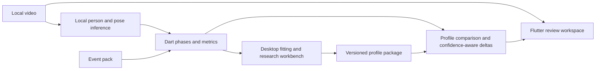

# STRATHVISION architecture

The shipped prototype has three layers: a Flutter review client, a pure-Dart analysis engine, and event packs. Python is research tooling; there is no separate Rust/Python production core.

## Code boundaries

- [Workspace](../apps/strathvision/lib/workspace): native media_kit players, synchronization, marks and saved projects; video review works independently of analysis.
- [Vision](../apps/strathvision/lib/vision): person/athlete selection and BlazePose through ONNX Runtime. Training paths reject unresolved identity/orientation. Implement position is derived from grip/forearm geometry; no research detector is promoted.
- [Analysis engine](../packages/analysis_engine/lib/src): stage interfaces, segmentation, metrics, profile gates, comparison and bounded edits. [Packs](../apps/strathvision/assets/packs) supply event definitions and weights.
- [Package exchange](../apps/strathvision/lib/profiles/package_exchange.dart): generated private storage names, transactional metadata/extras, event-bound marks and content-based local-video matching.
- [Dataset tooling](../tools/datasets): read-only, sport-agnostic inventories, exact-content aliases and reviewed recording/session split guards. These private research artifacts are separate from app packages; see [dataset contracts](DATASETS.md).
- [Research tooling](../tools/carne_asada): private dataset preparation and evaluation. Published reports retain failed and zero-edit results.

## Device roles and transfer

Desktop builds profiles, tunes specialist heads and runs CARNE ASADA. Phone reviews, annotates and performs inference with imported packages. Profile fitting and weight editing are not mobile flows. Packages move as files, manually or through a user-selected inbox folder. Automatic peer discovery/push is a design direction, not implemented synchronization.

SQLite/Drift stores projects, profile metadata, settings and comparisons. The app owns imported package copies. Videos remain where the user placed them. Exported marks omit filesystem paths; hashes establish byte identity, not person identity, authorship or independent recording sessions. Legacy marks remain unbound when source identity is missing.

## Evidence boundaries

A profile passes count, confidence and self-consistency checks before being used. Self-consistency is not external accuracy. Comparison scores retain their historical meaning while `confidence-v1` orders deltas by contribution times minimum pose/phase/metric confidence and demotes values below 0.6. This is a heuristic, not calibrated uncertainty.

Specialist patches and compiled adapters run locally. Optional adapter creation uses a configured provider on desktop. CARNE ASADA edits are bounded, versioned and reversible; real coaching improvement still needs genuine labels and an independent session holdout. Local voice transcription remains unimplemented.

Exact contracts: [INTERFACES](INTERFACES.md). Rationale and historical decisions: [DECISIONS](DECISIONS.md). Acceptance status: [VALIDATION](VALIDATION.md) and [ROADMAP](ROADMAP.md).
